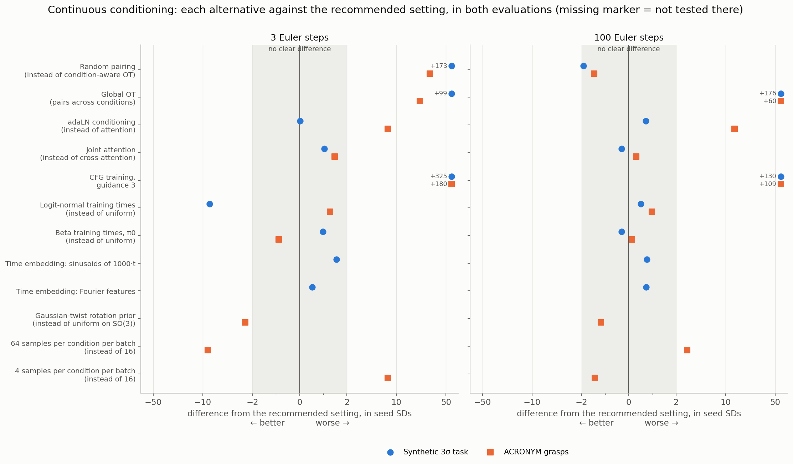
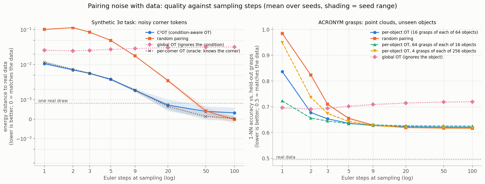
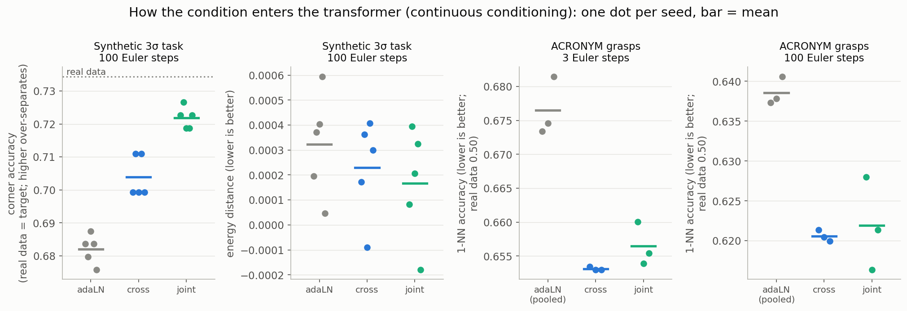
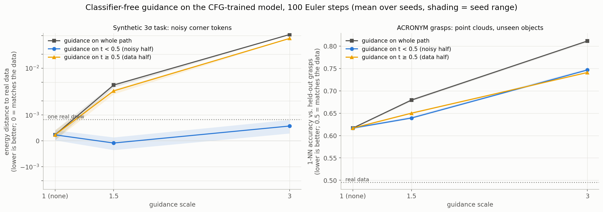
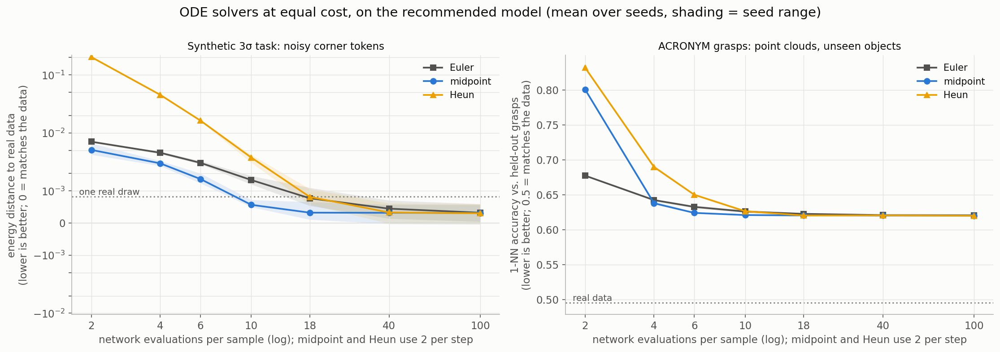
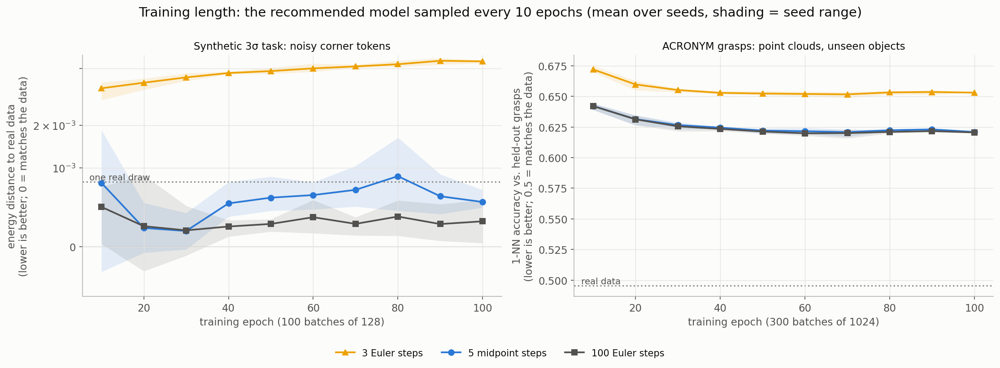
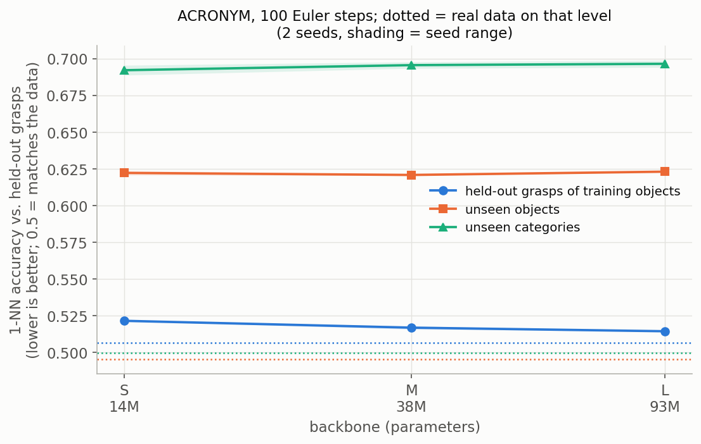

# Continuous conditioning: how to train pose-generation flow models

**What this answers:** which training and sampling settings give the best SE(3) pose samples when the model is
conditioned on a continuous signal, i.e. one where no two training samples share exactly the same condition.

**Two evaluations, looked at together:**
- **Synthetic 3σ task.** Eight goal poses, every one within 3σ of every other. The condition names a corner with a
  noisy token, so every condition is slightly different. Quality is the **energy distance** to real samples: 0 means
  the samples match the data. 5 seeds per setting.
- **ACRONYM grasps.** Real Franka grasps of 606 household objects. The condition is the object's **point cloud**, and
  the model is scored on **objects it never saw**. Quality is the **1-NN accuracy**: how well a nearest-neighbour test
  can tell generated grasps from real ones. 0.5 means it can't. 3 seeds per setting.

Where the two agree, the result is likely to hold for other continuous-conditioning pose tasks.

## Recommended settings

1. **Pair noise with data only within the same condition, or nearby ones.**
   - If many samples share an underlying condition, pair within each group (`--pairing ot`). For ACRONYM the group is
     the object: every grasp of an object shares its point cloud.
   - Put many samples of each group in a batch: 64 per object beat 16.
   - If no two samples share a condition, use C²OT (`--pairing c2ot --ot_batch_mult 1`, `--r_tar` from
     `./pose_ablations.sh calibrate`).
   - Never pair across conditions (global OT).
2. **Feed the condition to the network through attention** (`--cond_mode cross_attn`).
   - Joint attention (`--cond_mode joint`) is as good, and is the better choice when the condition is only a few
     tokens.
   - With many tokens (a point cloud's 64 patches) it costs 8× more to train.
   - Don't use adaLN on a pooled condition.
3. **Train without CFG and don't guide** (`--no_cfg`).
4. **Sample with 5 midpoint steps** (10 network evaluations). With a budget of only 2 evaluations, take 2 Euler steps.
   Never use Heun.
5. **Keep the framework's defaults** for everything else:
   - uniform training times;
   - sinusoids of t as the time embedding;
   - a prior that is uniform over rotations, for grasp-like poses that can face any direction.
6. **Don't expect a bigger model to generalise better.**
   - On ACRONYM, a 38M-parameter backbone (`--hidden_dim 384 --num_layers 8 --num_heads 6`) matches 93M on unseen
     objects.
   - The synthetic task needs only the default 1.3M.
7. **Training can stop early:** quality on held-out conditions stops improving after about 20% (synthetic) to 50%
   (ACRONYM) of the 100 epochs run here.

## Where the two evaluations agree

*Each row swaps one recommended setting for an alternative. Each marker is how much worse (right) or better (left)
that makes the samples, in units of the seed-to-seed standard deviation. The grey band, within 2 SDs, is no clear
difference. Off-scale differences are written next to the marker. Left: 3 Euler steps (fast sampling); right: 100
Euler steps.*

**They agree on:**
- **Pairing across conditions fails** in both. Random pairing costs nothing at 100 steps, but is far worse when
  sampling fast.
- **CFG with guidance 3 is the worst option** everywhere.
- **More samples per condition per batch** gives faster sampling: 64 beat 16, and 4 is worse. That was only tested on
  ACRONYM, but it is the same mechanism as pairing within conditions.
- **The training-time and time-embedding alternatives** are within noise at 100 steps.

**They disagree on:**
- **Logit-normal training times** help the synthetic task at 1–3 steps, but make no difference on ACRONYM.
- **adaLN** is much worse on ACRONYM's unseen objects. On the synthetic task its energy distance ties attention, but
  it separates the corners less well than the data does (below).

## The evidence

### Pairing noise with data

- **Condition-aware pairing is what makes few-step sampling work.**
  - Synthetic, at 3 steps: C²OT reaches 0.0056 against 0.085 for random pairing. That's as good as an oracle that
    knows each sample's corner.
  - ACRONYM, at 3 steps: 0.653 against 0.710.
- **Random pairing catches up by 20–50 steps.** At 100 steps it is level or marginally better.
- **Global OT, which pairs regardless of condition, stalls far from the data.** It gives each condition a skewed part
  of the noise.
- **More samples per object per batch straighten the paths further** (ACRONYM).
  - 64 grasps of each of 16 objects: 0.722 at 1 step, against 0.836 for 16 of each of 64.
  - 4 of each of 256 objects: 0.949.
  - At 100 steps, 64 per object is slightly worse on seen objects (0.521 vs. 0.516).

### How the condition enters the network

- **Attention beats adaLN.**
  - On ACRONYM, adaLN on a pooled cloud feature is clearly worse on unseen objects: 0.639 vs. 0.621 at 100 steps,
    and 0.677 vs. 0.653 at 3.
  - On the synthetic task, attention separates the corners closer to the data (joint 0.722, cross 0.704, adaLN
    0.682; real data 0.734), with energy distance tied.
- **Joint and cross-attention tie on ACRONYM.** Joint attention puts all 64 patch tokens in every sample's sequence,
  so it trains 8× slower there; cross-attention is the practical choice for large conditions.

### Guidance

- **Guidance over the whole path is harmful in both.**
- **The noisy half (t < 0.5) is the least harmful place to guide.**
  - On the synthetic task, mild guidance there (scale 1.5) helps slightly: −0.0001 vs. 0.0002, better on every seed.
  - On ACRONYM even that hurts (0.639 vs. 0.617).
- **Since the real data shows no gain, train without CFG.** That also halves the sampling cost.

### Sampling: solver and number of steps

- **Midpoint is the best solver from 4 evaluations up**, and 10 evaluations (5 steps) reach the 100-step quality on
  ACRONYM (0.621). On the synthetic task, 10 evaluations give 0.0006 against 0.0015 for Euler.
- **At 2 evaluations, two Euler steps beat one midpoint step** (ACRONYM: 0.677 vs. 0.801).
- **Heun is the worst at low budgets** in both, and only catches up at about 18 evaluations.

### Training length and model size

- **Quality stops improving early.**
  - Synthetic: the 100-step energy distance is at the floor by epoch 20.
  - ACRONYM: unseen-object quality is flat from epoch 50 (0.622 at 50, 0.621 at 100).
- **Fast Euler sampling (3 steps) gets slightly worse with longer training** on the synthetic task (0.0036 → 0.0056).
  Midpoint sampling doesn't.

- **A bigger backbone helps on objects the model has seen, not on new ones.** From 14M to 93M parameters:
  - held-out grasps of training objects improve from 0.522 to 0.515;
  - unseen objects stay at 0.62;
  - unseen categories stay at 0.69–0.70.

## What's still open

- **Generalisation to new objects is the real gap.** Unseen objects score 0.62 and unseen categories 0.70, against
  0.50 for real data and 0.516 on seen objects.
  - Model size, pairing, training times and the prior don't close it.
  - The point-cloud encoder and the number of training objects are the untested levers.
  - A few unusually large unseen objects fail outright (a 0.34 m bottle scores 0.99), which looks like extrapolation
    beyond the training objects' sizes.
- **The best settings were tested one at a time against a baseline, not combined.** An example is 64 samples per
  object together with midpoint sampling.
- **On the synthetic task the best models sit at the metric's floor at 100 steps.** 256 evaluation samples can't
  separate them.

## How it was measured

- **Synthetic task** (`configs/pose_tasks/corners_3sigma_jitter.yaml`):
  - Four corners, each with two goal orientations; every pair of goals is within 3σ, so the modes overlap.
  - Each condition token gets Gaussian noise (std 0.1).
  - Training: 100 epochs of 100 batches of 128.
  - Evaluation: 256 samples per model.
  - Results: `experiments/results/sota_geo/pose_corners_3sigma_jitter/`.
- **ACRONYM** (`configs/pose_tasks/acronym_10cat_points.yaml`):
  - Successful grasps of 10 object categories, in each object's frame.
  - The condition is a 2,048-point surface cloud, tokenised into 64 patches.
  - Training: 30k steps of 64 objects × 16 grasps.
  - Evaluation: 64 unseen objects × 256 samples, each scored against its own real grasps on the gripper's control
    points. Held-out categories (Cup, Camera, Guitar) are scored the same way.
  - Results: `experiments/results/sota/pose_acronym_10cat_points/`.
- **Common to both:**
  - The current framework: adaLN-Zero transformer, EMA weights, uniform continuous training times.
  - Each alternative retrains the recommended setting with one choice changed.
  - The rotation bug fixed on 2026-10-15 affects neither.
- **Figures:** `python experiments/combined_figures.py --kind continuous`.
- **Previous reports:**
  - The full per-study write-ups are `ablations_summary.md` at tag `pose-3sigma-geo-v1` and
    `acronym_ablations_summary.md` at tag `acronym-continuous-v1`.
  - They include the original model, calibration details and every arm's numbers.
  - The commands to rerun everything are in their Reproducing sections.
