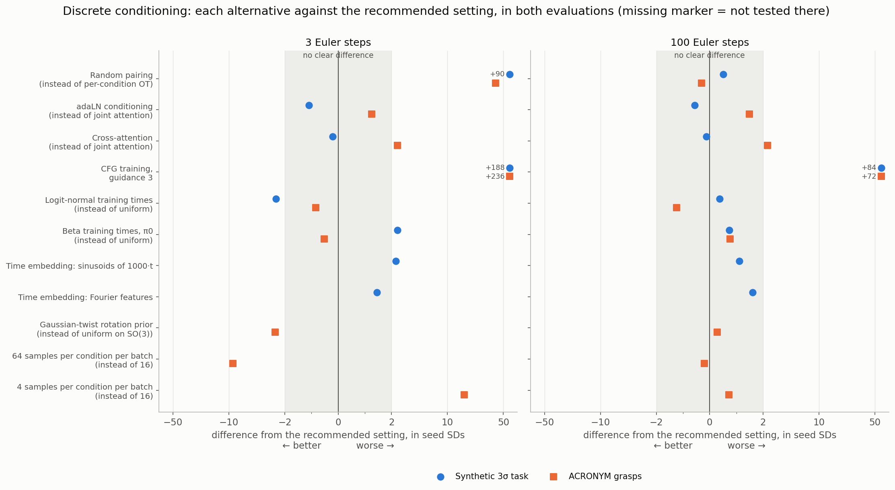
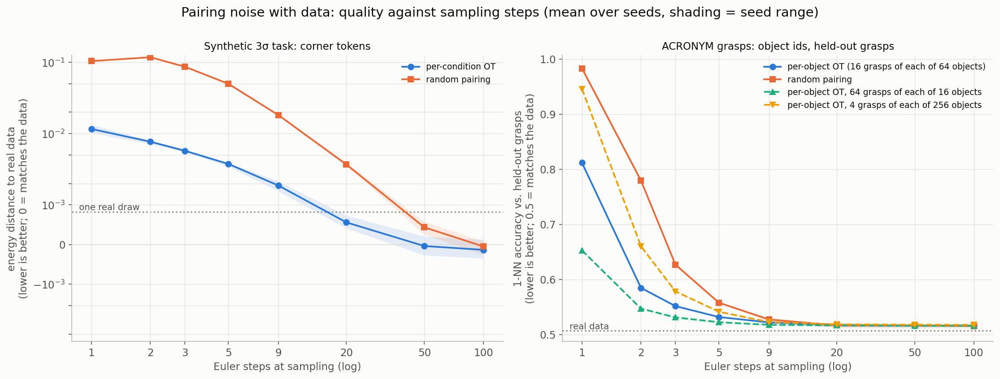
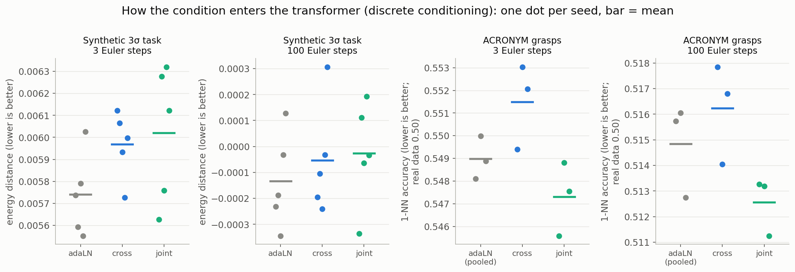
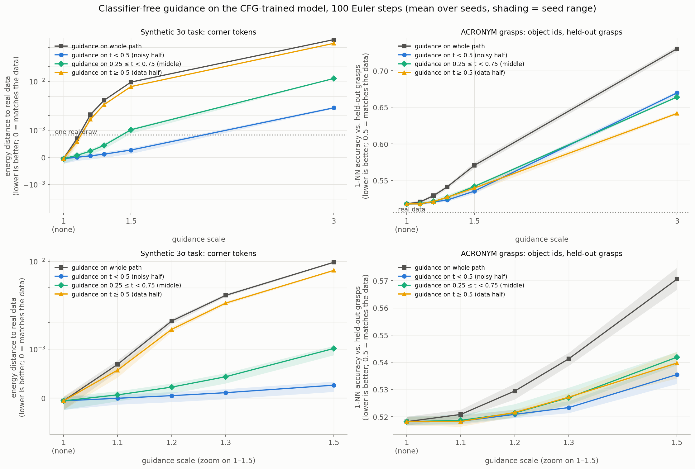
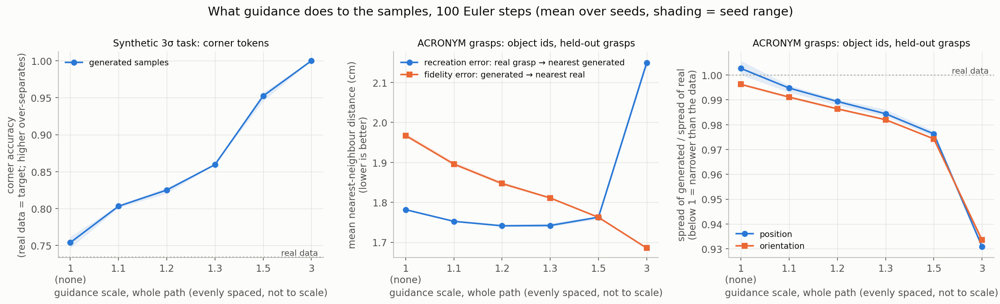
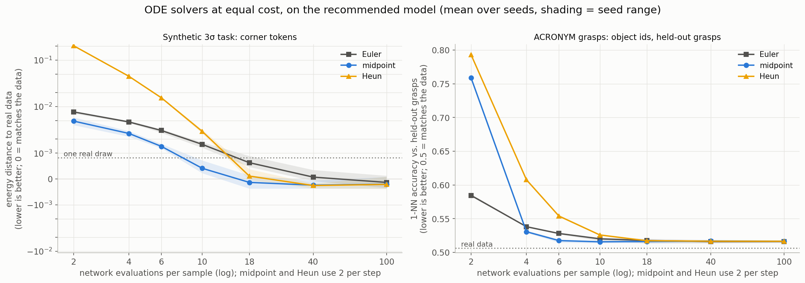
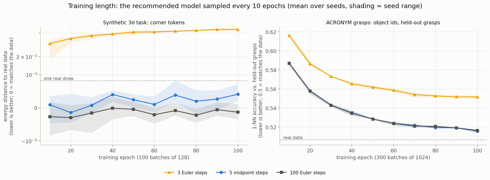
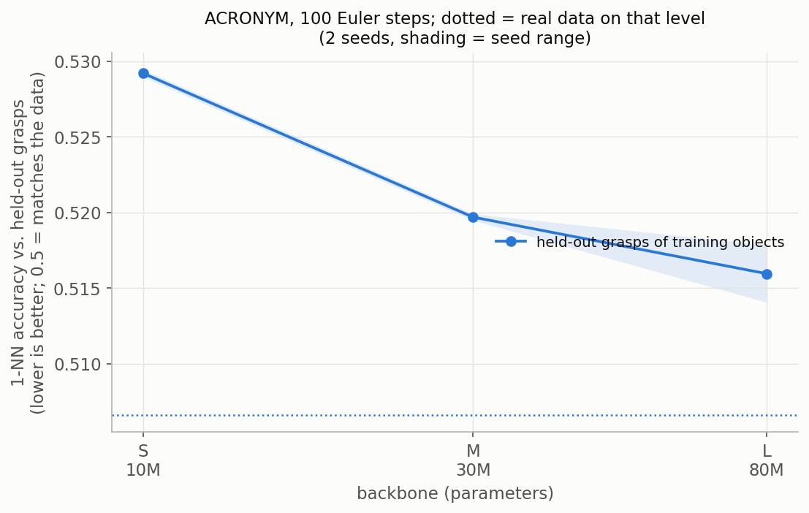

# Discrete conditioning: how to train pose-generation flow models

**What this answers:** which training and sampling settings give the best SE(3) pose samples when the model is
conditioned on a discrete label, a token that many training samples share.

**Two evaluations, looked at together:**
- **Synthetic 3σ task.** Eight goal poses, every one within 3σ of every other. Clean tokens name one of four corners,
  and each corner holds two goal orientations. Quality is the **energy distance** to real samples: 0 means the samples
  match the data. 5 seeds per setting.
- **ACRONYM grasps.** Real Franka grasps of 606 household objects. The condition is the object's **id** (with its
  category), and the model is scored on **held-out grasps of those objects**. Quality is the **1-NN accuracy**: how
  well a nearest-neighbour test can tell generated grasps from real ones. 0.5 means it can't. 3 seeds per setting.

Where the two agree, the result is likely to hold for other discrete-conditioning pose tasks.

## Recommended settings

1. **Pair noise with data by minibatch OT within each condition** (`--pairing ot`, the default).
   - Put many samples of each condition in a batch: 64 per object beat 16 by a wide margin at 1–3 steps.
2. **Use joint attention for the condition tokens** (`--cond_mode joint`).
   - The three pathways are within noise of each other on the synthetic task. Joint attention is slightly best on
     ACRONYM.
   - With a few tokens it costs nothing extra; adaLN and cross-attention are close behind.
3. **Train without CFG and don't guide** (`--no_cfg`).
   - No guidance scale helps, not even 1.1–1.3, where the original CFG paper found its best results.
4. **Sample with 5 midpoint steps** (10 network evaluations). With a budget of only 2 evaluations, take 2 Euler steps.
   Never use Heun.
5. **Keep the framework's defaults** for everything else:
   - uniform training times;
   - sinusoids of t as the time embedding;
   - a prior that is uniform over rotations, for grasp-like poses that can face any direction.
6. **Size the model to the number of conditions.**
   - A few conditions need little: the synthetic task's four corners are fully learned by the default 1.3M-parameter
     model.
   - Many conditions need capacity: for 606 objects, quality improves up to the largest backbone tried, 80M
     parameters (`--hidden_dim 512 --num_layers 12 --num_heads 8`).
7. **Train longer when there are many conditions.**
   - The synthetic task reaches the data floor within 10–20 of 100 epochs.
   - ACRONYM is still improving at the end of its 30k steps.

## Where the two evaluations agree

*Each row swaps one recommended setting for an alternative. Each marker is how much worse (right) or better (left)
that makes the samples, in units of the seed-to-seed standard deviation. The grey band, within 2 SDs, is no clear
difference. Off-scale differences are written next to the marker. Left: 3 Euler steps (fast sampling); right: 100
Euler steps.*

**They agree on:**
- **Random pairing** is far worse when sampling fast, and level at 100 steps.
- **CFG with guidance 3 is the worst option** everywhere.
- **The condition pathway, training-time density and time embedding barely matter.** Every alternative is within or
  near the no-difference band, except where noted below.

**Tested only on ACRONYM:**
- **More samples per condition per batch** is the largest gain at 3 steps.
- **A Gaussian-twist rotation prior** is slightly better at 3 steps and level at 100.

**They disagree on:** logit-normal training times help the synthetic task at 1–3 steps, but make no clear difference
on ACRONYM.

## The evidence

### Pairing noise with data

- **OT within each condition is what makes few-step sampling work.**
  - Synthetic, at 3 steps: 0.0057 against 0.087 for random pairing.
  - ACRONYM: 0.812 against 0.983 at 1 step, and 0.551 against 0.627 at 3.
- **At 100 steps the two are level** in both evaluations, so pairing only matters for fast sampling.
- **More samples of each object per batch straighten the paths further** (ACRONYM).
  - 64 grasps of each of 16 objects: 0.653 at 1 step and 0.531 at 3, against 0.812 and 0.551 for 16 of each of 64.
  - 4 of each of 256 objects: 0.946 at 1 step.
  - All are level at 100 steps.

### How the condition enters the network

- **On the synthetic task, adaLN, cross-attention and joint attention are within seed noise** at every step count.
- **On ACRONYM, joint attention is slightly best:** 0.513 at 100 steps, against 0.516 for cross-attention and 0.515
  for adaLN. The gap is small, about 2 seed SDs, but consistent across step counts.

### Guidance

- **No guidance setting is better than none**, including the small scales (1.1–1.3) where the original CFG paper
  found its best results.
  - ACRONYM: scale 1.1, and 1.2 on the noisy half or the middle of the path, are level with unguided (0.518–0.521),
    none better. Larger scales are worse: 0.523–0.541 at 1.3, 0.54–0.57 at 1.5 and 0.64–0.73 at 3.
  - Synthetic: guiding only the noisy half (t < 0.5) is level up to scale 1.3, and the middle (0.25 ≤ t < 0.75) at
    1.1. Every other setting is worse, e.g. 0.0007 at 1.1 over the whole path and 0.072 at 3, against −0.0001
    unguided.
- **Where it is applied matters.** Guidance over the whole path does the most damage. On the synthetic task the
  noisy half is least harmful by far (0.0029 at scale 3). On ACRONYM the three partial intervals are similar.

- **Guidance narrows the samples.** On the synthetic task it separates the corners more sharply than the real data
  does: 0.80 at scale 1.1 and 1.00 at 3, against 0.75 unguided and 0.73 for real data. On ACRONYM the spread of the
  grasps falls to 98% of the real spread at 1.3 and 93% at 3.
- **Mild guidance improves the nearest-neighbour errors while the distribution gets worse.** On ACRONYM, scale
  1.2–1.5 brings generated grasps closer to real ones (fidelity error 1.97 → 1.76–1.85 cm) and real grasps closer to
  generated ones (recreation error 1.78 → as low as 1.73 cm). The samples concentrate on the common grasps, so the average
  distance falls, but the rarer grasps are under-sampled, which 1-NN accuracy detects. At scale 3 recreation error
  rises to 2.15 cm.

**How this fits the literature.** CFG was introduced as a way to trade diversity for fidelity, like truncation in
GANs ([Ho & Salimans 2022](https://arxiv.org/abs/2207.12598)). Even there, the distribution metric (FID) improved
only at small scales, best at 1.1 on ImageNet 64×64, and got worse beyond them. The large FID gains in later image
models come mostly from correcting model error: an imperfect conditional model spreads samples too widely, and
guidance pulls them back ([Karras et al. 2024](https://arxiv.org/abs/2406.02507)). FID also rewards class-typical
images ([Kynkäänniemi et al. 2023](https://arxiv.org/abs/2203.06026)). Guidance doesn't sample the conditional
distribution; it pushes samples towards the edges of it ([Bradley & Nakkiran 2024](https://arxiv.org/abs/2408.09000),
[Chidambaram et al. 2024](https://arxiv.org/abs/2409.13074)). Here the ID-conditioned models are close to the data
floor, so there is little error for guidance to correct, and both metrics measure the distribution directly, so they
see the narrowing.

### Sampling: solver and number of steps

- **Midpoint is the best solver from 4 evaluations up.**
  - On ACRONYM, 6 evaluations (3 steps) reach the 100-step quality (0.517 vs. 0.516).
  - On the synthetic task, 10 evaluations give 0.0004 against 0.0015 for Euler.
- **At 2 evaluations, two Euler steps beat one midpoint step** (ACRONYM: 0.585 vs. 0.759).
- **Heun is the worst at low budgets** in both, and only catches up at about 18 evaluations.

### Training length and model size

- **The synthetic task is learned almost immediately:** the 100-step energy distance is at the data floor from
  epoch 10.
- **ACRONYM keeps improving until the end:** 0.528 at epoch 50, 0.516 at epoch 100. Train it longer.
- **Fast Euler sampling (3 steps) gets slightly worse with longer training** on the synthetic task (0.0033 →
  0.0057). Midpoint sampling doesn't.

- **Capacity helps when every evaluation object was seen in training:** 0.529, 0.520 and 0.516 for 10M, 30M and 80M
  parameters, with diminishing returns.

## What's still open

- **The best settings were tested one at a time against a baseline, not combined.** An example is 64 samples per
  object together with joint attention.
- **The ACRONYM model is not converged** at 30k steps, and its quality might keep rising with a larger backbone.
- **On the synthetic task the best models sit at the metric's floor at 100 steps.** 256 evaluation samples can't
  separate them.
- **An ID-conditioned model can't generate for objects it hasn't seen.** For new objects, see
  [ablations_continuous.md](ablations_continuous.md). On seen objects the point-cloud model matches the ID model
  (0.516 at 100 steps).

## How it was measured

- **Synthetic task** (`configs/pose_tasks/corners_3sigma.yaml`):
  - Four corners, each with two goal orientations; every pair of goals is within 3σ, so the modes overlap.
  - Two clean tokens name the corner.
  - Training: 100 epochs of 100 batches of 128.
  - Evaluation: 256 samples per model.
  - Results: `experiments/results/sota_geo/pose_corners_3sigma/`.
- **ACRONYM** (`configs/pose_tasks/acronym_10cat_ids.yaml`):
  - Successful grasps of 10 object categories, in each object's frame.
  - The condition is two id tokens, `[category, object]`.
  - Training: 30k steps of 64 objects × 16 grasps.
  - Evaluation: 64 training objects × 256 samples, each scored against that object's held-out grasps (15% of its
    grasps, never trained on), on the gripper's control points.
  - Results: `experiments/results/sota/pose_acronym_10cat_ids/`.
- **Common to both:**
  - The current framework: adaLN-Zero transformer, EMA weights, uniform continuous training times.
  - Each alternative retrains the recommended setting with one choice changed.
- **Figures:** `python experiments/combined_figures.py --kind discrete`.
- **Previous reports:**
  - The full per-study write-ups are `ablations_summary.md` at tag `pose-3sigma-geo-v1` and
    `acronym_ablations_summary.md` at tag `acronym-discrete-v1`.
  - They include the original model and every arm's numbers.
  - The commands to rerun everything are in their Reproducing sections.
