# Real grasp poses: flow matching ablations on ACRONYM

**Question:** which conclusions of the synthetic study ([ablations_summary.md](ablations_summary.md)) hold on
real robot grasp poses, and what changes?

**Scope:** parallel-jaw (Franka) grasps from ACRONYM [Eppner et al. 2021], 10 training categories (757 objects),
with the current model and training framework. Two kinds of conditioning:
- **Part 1, continuous:** the model sees the object's point cloud.
- **Part 2, discrete:** the model sees `[category, object]` id tokens.

Quality means **pose recreation**: how closely generated grasps reproduce real grasps the model never saw. There is
no physics or grasp-success metric.

## Recommendations

The primary metric is the **1-NN two-sample accuracy** against held-out real grasps: 0.5 means a nearest-neighbour
test can't tell the samples from real grasps; higher is worse. A real grasp set of the same size scores 0.496–0.507.
Recreation error (cm) is the readable companion. It is the distance from each real grasp to the nearest sample,
measured on the gripper's control points. 3 seeds per configuration.

### Point-cloud conditioning (Part 1)

**Best configuration:** the M backbone (38M parameters) with cross-attention to point-patch tokens, per-object
minibatch OT, no CFG, sampled with 3–5 midpoint steps. 1-NN accuracy at 10 network evaluations:
- **0.621** on unseen objects of the training categories (real data 0.496);
- **0.516** on held-out grasps of training objects (real data 0.507).

1. **Backbone: M** (`--hidden_dim 384 --num_layers 8 --num_heads 6`). A bigger trunk improves seen objects but not
   unseen ones (S / M / L: 0.622 / 0.621 / 0.623). The generalisation gap is not a capacity problem.
   [Details](#1-backbone-size)
2. **Condition the transformer by cross-attention to patch tokens** (`--cond_mode cross_attn`, the default here).
   - adaLN on a pooled cloud feature memorises: it is better on seen objects but clearly worse on unseen ones
     (0.639 vs. 0.621) and unseen categories (0.716 vs. 0.696).
   - Joint attention ties cross-attention at 8× the training cost.
   - [Details](#4-single-axis-ablations)
3. **Pair noise with data by minibatch OT within each object** (`--pairing ot`).
   - At 3 Euler steps it is clearly better than random pairing (0.653 vs. 0.710). At 100 steps they are level.
   - More grasps per object per batch straightens paths further. With 64 per object (16 objects per batch),
     1 Euler step gives 0.722 against 0.836 with 16 per object. The cost is a slightly worse 100-step score on seen
     objects (0.521 vs. 0.516).
   - Avoid global OT, which pairs across objects: 0.719 at 100 steps.
   - [Details](#2-pairing-and-cfg)
4. **Train without CFG and don't guide.** Every guidance scale above 1 is worse, even 1.5. If you guide anyway,
   guide only the data half of the path (t ≥ 0.5). [Details](#6-guidance)
5. **Sample with 3–5 midpoint steps.** They reach the 100-step quality (0.624 at 3 steps, 0.621 at 5). At a
   2-evaluation budget take 2 Euler steps, not 1 midpoint step (0.677 vs. 0.801). Avoid Heun.
   [Details](#5-ode-solvers-at-equal-cost)
6. **Keep the defaults for the prior and the training times.**
   - Uniform-SO(3) rotations and a Gaussian-twist prior tie.
   - Uniform t ties logit-normal and Beta.
   - **15k steps are enough:** unseen-object quality is flat from epoch 50 of 100.
     [Details](#7-training-length)
7. **Expect a generalisation gap.**
   - Unseen objects score 0.62 and unseen categories 0.70, against 0.50 for real data.
   - A few unusually tall unseen objects fail outright. A 0.34 m bottle scores 0.99.
   - [Details](#3-generalisation-seen-objects-unseen-objects-unseen-categories)

### ID conditioning (Part 2)

**Best configuration:** the L backbone (80M parameters), per-object minibatch OT, no CFG, sampled with 3–5
midpoint steps. 1-NN accuracy **0.516–0.517** on held-out grasps of the training objects (real data 0.507).

1. **Backbone: L** (`--hidden_dim 512 --num_layers 12 --num_heads 8`). Here capacity helps (S / M / L: 0.529 /
   0.520 / 0.516), because every evaluation object was seen in training. [Details](#1-backbone-size)
2. **Per-object OT** (`--pairing ot`). It is decisive at few steps: at 1 step 0.812 vs. 0.983 for random pairing,
   at 3 steps 0.551 vs. 0.627. At 100 steps they are level. [Details](#2-pairing-and-cfg)
3. **Train without CFG and don't guide.** Guidance 3 trades recall for precision:
   - fidelity error improves, 1.69 vs. 1.95 cm;
   - recreation error worsens, 2.15 vs. 1.77 cm;
   - 1-NN accuracy degrades to 0.73.

   [Details](#6-guidance)
4. **Sample with 3–5 midpoint steps** (0.517 at 3, 0.516 at 5). At a 2-evaluation budget take 2 Euler steps (0.585
   vs. 0.759). [Details](#5-ode-solvers-at-equal-cost)
5. **Put more grasps of each object in a batch** (`--grasps_per_object 64`, i.e. 16 objects of 64 grasps). It
   straightens the paths: 1 step 0.653 vs. 0.812, 3 steps 0.531 vs. 0.551, the same at 100 steps. Don't go down to 4
   per object (1 step 0.946). [Details](#4-single-axis-ablations)
6. **Prefer joint attention for the ID tokens** (`--cond_mode joint`). It gives a small, consistent gain (0.513 vs.
   0.516 at 100 steps, 4.3 seed SDs), at almost no cost with 2 tokens. adaLN and cross-attention are close behind.
7. **Keep the defaults for the prior and the training times.** A Gaussian-twist prior is slightly better at 3 steps
   (0.546 vs. 0.551) and level at 100. Logit-normal and Beta t tie.
8. **Train longer than 30k steps.** Seen-object quality is still improving at the end of training.
   [Details](#7-training-length)

Items 5–6 were each measured against the baseline, not together.

### What transferred from the synthetic study

| Finding on the synthetic 3σ task | On real grasps |
|---|---|
| Minibatch OT within each condition makes few-step sampling work; level at 100 steps | **Holds** in both parts |
| Global OT across conditions fails | **Holds** (point clouds: 0.719 vs. 0.621) |
| CFG training gains nothing; strong guidance hurts | **Holds** |
| Guidance only in the noisy half (t < 0.5) is nearly free | **Reversed**: the data half (t ≥ 0.5) hurts least, and any guidance hurts |
| Midpoint is the best solver at ~10 evaluations; Heun is poor at low budgets | **Holds** |
| Uniform t beats logit-normal and Beta | Ties: no gain from either |
| Joint attention slightly beats adaLN for continuous conditions | Point clouds: joint ties cross-attention at 8× the cost, and adaLN (pooled) is worst on unseen objects. IDs: joint is slightly best |
| (no analogue) | More grasps of each object per batch (a bigger per-condition OT minibatch) gives much better 1–3 step samples |
| (no analogue) | A bigger backbone helps seen objects but not unseen ones |

The synthetic models were trained with a bug that this study found and fixed: about 10% of their training pairs
rotated the long way round. Fixing it improves the synthetic baseline by 6–13 SD at 2+ steps
([gate G0](#gates)). The synthetic study will be rerun with the fix, so its numbers, not necessarily these
directions, may move.

## Setup

### Data

- **Source:** ACRONYM grasps: 2,000 simulated Franka grasps per object, labelled by whether the object stayed in the
  gripper. Only the successful ones are kept.
- **Training categories (10):** Mug, Bowl, Bottle, Vase, Laptop, CellPhone, Book, Pencil, ToyFigure, Chair. That is
  up to 100 objects per category with ≥ 200 successful grasps each, 757 objects in all.
- **Held-out levels:**
  1. **held-out grasps**: 15% of each training object's grasps (125k);
  2. **held-out objects**: 20% of each training category's objects (151 objects, 213k grasps);
  3. **held-out categories**: Cup, Camera, Guitar (95 objects, 134k grasps).

  Training uses 711k grasps of 606 objects. ID conditioning can only be evaluated on level 1.
- **Frames and units:**
  - Each grasp is a pose in its object's frame, centred on ACRONYM's centre of mass.
  - The gripper frame sits at the centre of the finger pads.
  - Positions are in units of 6.1 cm, the training grasps' position spread.
- **Point clouds:** 16 surface samplings of 2,048 points per object, from watertight versions of the ShapeNetSem
  meshes.
  - The meshes were made with Manifold, without the `-s` and `simplify` steps ACRONYM used: those corrupted 239 of
    the 852 meshes here.
  - The resulting surfaces are within 0.8–1.3 mm of ACRONYM's own meshes.
  - Grasp centres lie a median 5.3 mm from the clouds.
- **Training batches:** 64 objects × 16 grasps. Each goal grasp gets a random half turn about the approach axis,
  which makes the data symmetric under the jaw swap.

### Model and training

- **Model:** the current framework ([readme section 8](readme.md)) with two new condition encoders.
  - **Point clouds:** 64 patches. Farthest-point sampling picks the centres, each centre takes its 32 nearest points
    into a mini-PointNet, and 4 transformer layers mix the patches. Keys and values are computed once per object.
  - **IDs:** an embedding of `[category, object]`.
- **Prior:** uniform rotations on SO(3), and Gaussian translations.
- **Training:**
  - 30k steps of batch 1024, 2 flow times per pair;
  - AdamW at 1e-4, EMA 0.999, bf16;
  - about 1 hour per M point-cloud run on an RTX 4090, and 1.5 hours per L ID run.

### Evaluation and metrics

- **Evaluation sets:** 64 fixed objects per held-out level, 256 samples each, scored against up to 512 held-out real
  grasps of that object, then averaged over objects.
- **Distance:** every metric uses one distance between two grasps. It is the mean distance between the gripper's 5
  control points, minimised over the jaw swap, in cm.
- **Metrics:**

| Metric | Meaning |
|---|---|
| **1-NN accuracy** (primary) | Leave-one-out nearest-neighbour test, samples against real grasps. 0.5 = indistinguishable. |
| **Recreation error** | Real grasp → nearest sample (cm). Collapse scores badly. |
| **Fidelity error** | Sample → nearest real grasp (cm). Over-dispersion scores badly. |
| Energy distance | Mean and median over objects. The mean is dominated by the few objects a model fails on. |

- **Data floor:** every metric is also computed for a real grasp set of the same size. That gives the
  "real data" lines in the figures.
- **Size rule** (2 seeds): the smallest backbone within one seed SD of the best.
- **Baseline rule** (among the conditional no-CFG variants): the lowest score.
- **Score:** the mean of 1-NN accuracy at 3 and at 100 Euler steps.

### Gates

- **G0, framework:** the synthetic baseline after this study's framework changes. It found the long-way rotation bug
  (now fixed). bf16 and the other changes had no measurable effect.
- **G1, metrics:** real grasps score 1-NN accuracy 0.50 against held-out real grasps. A collapsed set fails
  recreation error, and an over-dispersed one fails fidelity error.
- **G2, smoke runs:** both parts train to within a few hundredths of the real-data 1-NN accuracy.

## Results

### 1. Backbone size

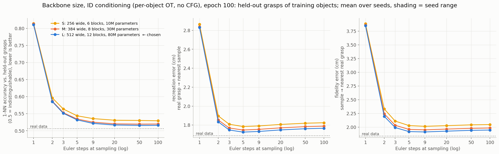
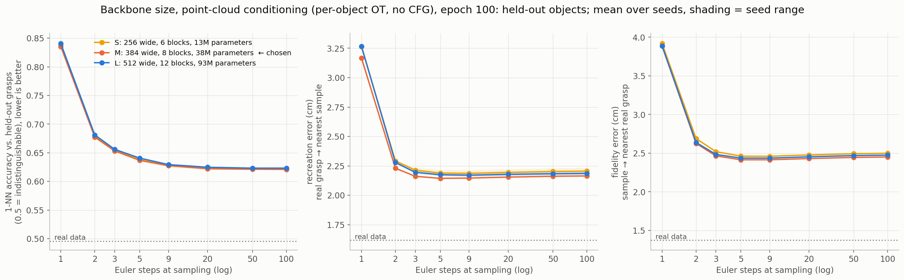

- **ID conditioning:** L wins on held-out grasps of training objects, with diminishing returns. S → M improves the
  score by 0.010, M → L by 0.003.
- **Point clouds:** size makes no difference on unseen objects. S scores slightly best on unseen categories (0.692,
  against 0.696 for M and 0.697 for L).

### 2. Pairing and CFG

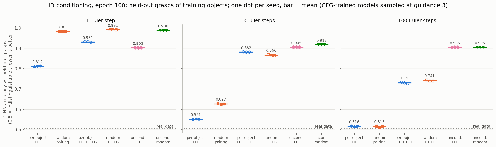
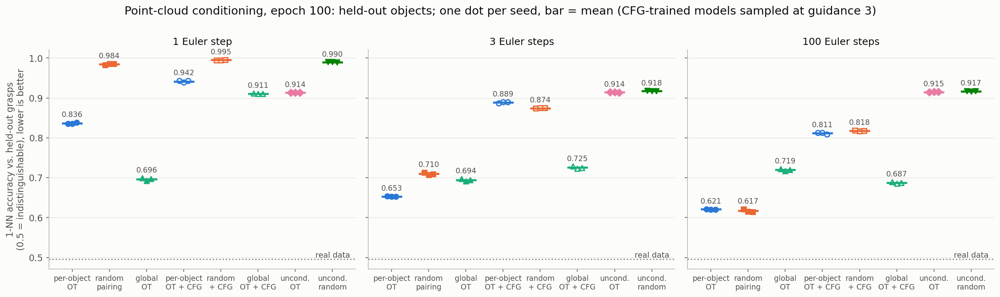

- **Per-object OT** gives the best few-step samples in both parts.
- **Random pairing** catches up by ~20 steps.
- **Global OT** gives the best single-step samples but the worst 100-step ones: pairing across objects hands each
  object a skewed part of the noise.
- **CFG-trained models sampled at guidance 3** are worse at every step count. The exception is global OT, where
  guidance partly repairs the skew (0.687 vs. 0.719).
- **Unconditional models** stall at 0.905–0.917.

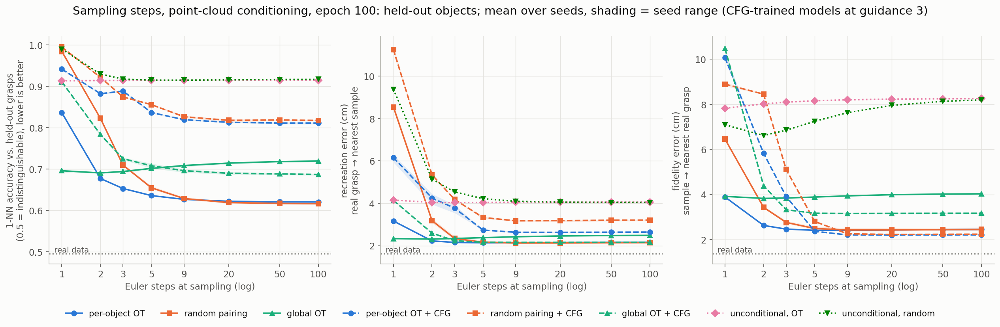

### 3. Generalisation: seen objects, unseen objects, unseen categories

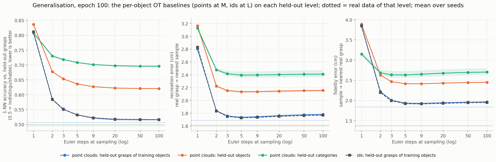

- **Seen objects:** on held-out grasps of training objects, point-cloud conditioning matches ID conditioning at
  every step count (0.516 at 100 steps for both). Conditioning on geometry costs nothing on known objects.
- **Unseen objects** leave a gap of ~0.11, and **unseen categories** one of ~0.18.
- **Heavy tail:** most unseen objects are close to their real grasps (the median object's energy distance is 0.09
  cm). A few large ones, e.g. tall bottles and toy figures of 0.25–0.34 m, fail outright: 1-NN accuracy ≥ 0.97.
  They look like extrapolation beyond the training objects' sizes.

### 4. Single-axis ablations

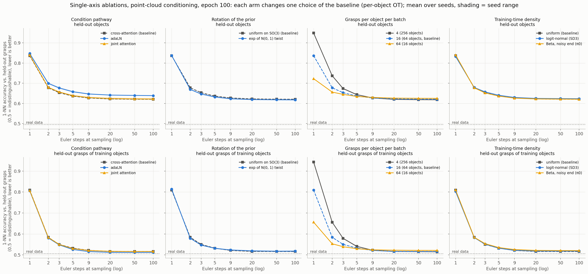

Each arm changes one choice of the baseline. Scores are in seed SDs from the baseline: held-out objects / held-out
grasps / held-out categories.

| Arm | Δ score (SD) | Reading |
|---|---|---|
| adaLN on a pooled cloud feature | +6.8 / −2.8 / +4.0 | memorises seen objects, generalises worse |
| joint attention | +0.5 / 0.0 / −0.1 | ties cross-attention at 8× the cost |
| Gaussian-twist prior | −1.4 / −0.3 / −0.4 | tie |
| 64 grasps per object (16 objects) | −3.6 / −2.5 / −0.4 | straighter paths: 1 step 0.722 vs. 0.836 |
| 4 grasps per object (256 objects) | +2.9 / +8.2 / +0.1 | 1 step 0.949 |
| logit-normal t | +0.8 / +0.7 / −0.2 | tie |
| Beta t | −0.3 / +3.4 / −1.1 | tie, slightly worse on seen objects |

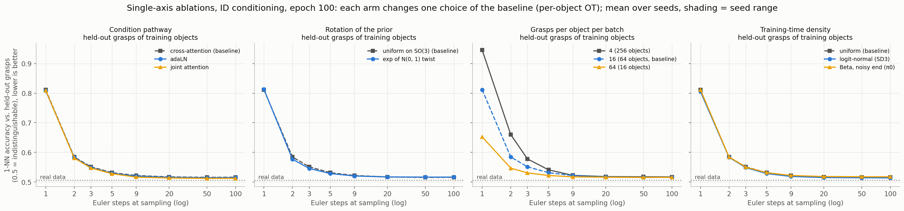

ID conditioning, held-out grasps of training objects:

| Arm | Δ score (SD) | 1-NN accuracy at 1 / 3 / 100 steps (baseline 0.812 / 0.551 / 0.516) |
|---|---|---|
| joint attention | −4.3 | 0.810 / 0.547 / 0.513 |
| adaLN | −1.8 | 0.808 / 0.549 / 0.515 |
| Gaussian-twist prior | −2.3 | 0.813 / 0.546 / 0.517 |
| 64 grasps per object (16 objects) | −7.0 | 0.653 / 0.531 / 0.516 |
| 4 grasps per object (256 objects) | +10.4 | 0.946 / 0.578 / 0.517 |
| logit-normal t | −0.9 | 0.806 / 0.549 / 0.514 |
| Beta t | +0.2 | 0.812 / 0.551 / 0.518 |

### 5. ODE solvers at equal cost

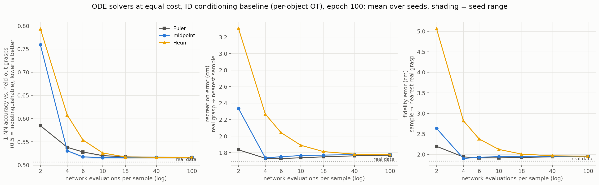
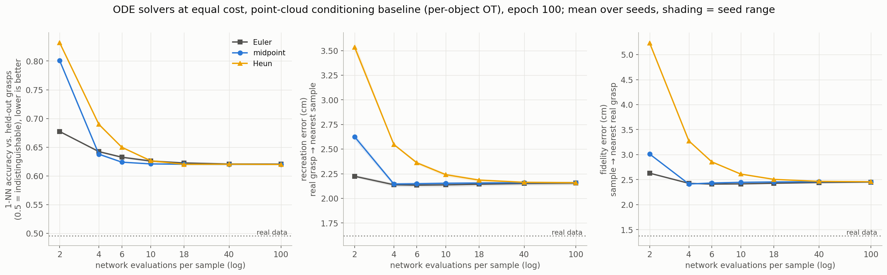

1-NN accuracy at 2 / 4 / 6 / 10 network evaluations:

| Solver | ID conditioning (held-out grasps) | Point clouds (unseen objects) |
|---|---|---|
| Euler | 0.585 / 0.538 / 0.528 / 0.520 | 0.677 / 0.642 / 0.633 / 0.626 |
| Midpoint | 0.759 / 0.531 / 0.517 / 0.516 | 0.801 / 0.638 / 0.624 / 0.621 |
| Heun | 0.793 / 0.608 / 0.554 / 0.526 | 0.832 / 0.690 / 0.650 / 0.626 |

### 6. Guidance

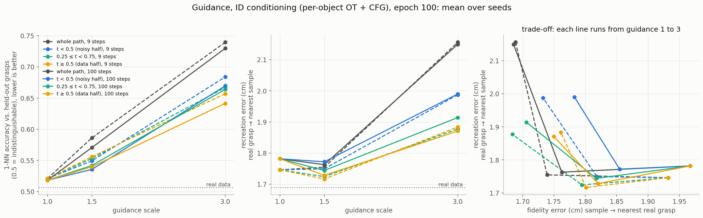
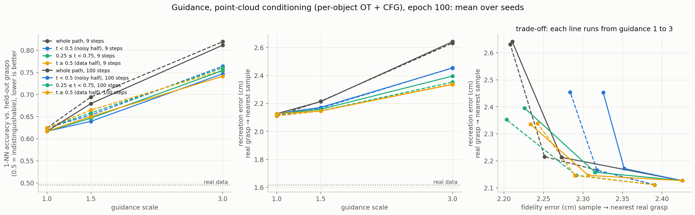

On the CFG-trained baselines:
- **Every scale above 1 raises 1-NN accuracy.** Guidance concentrates the samples: fidelity error falls while
  recreation error rises.
- **Restricting guidance to part of the path** reduces the harm, and the data half (t ≥ 0.5) hurts least. At scale
  3, 1-NN accuracy is 0.64 vs. 0.73 over the whole path for IDs, and 0.74 vs. 0.81 for point clouds.

### 7. Training length

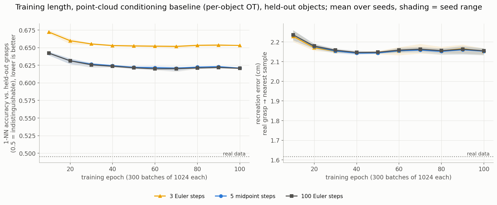
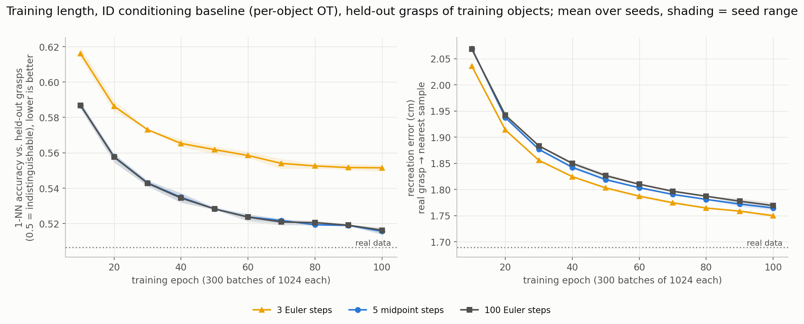

- **Unseen objects (point clouds)** plateau by epoch 50: 1-NN accuracy 0.622 at epoch 50, 0.621 at epoch 100.
  Recreation error is lowest around epochs 40–50. Half the training would do.
- **Seen objects (IDs)** are still improving at epoch 100: 0.528 at 50, 0.516 at 100, with recreation error still
  falling. Train the ID model longer than 30k steps.
- **Few-step quality:** unlike the synthetic task, 3-step Euler quality doesn't degrade with training here.

## Caveats

- **Proxy metrics:** these measure how well the real grasp distribution is reproduced. They don't measure whether a
  grasp would succeed.
- **Data source:** ACRONYM grasps are simulated (FleX). The reference sets are its successful grasps.
- **Nearest-neighbour metrics depend on set sizes.** Compare them with the real-data line of the same level, not
  across levels.
- **Energy distance** averaged over objects is dominated by the few objects a model fails on; the median is
  reported alongside.
- **Seeds:** 3 per configuration, 2 for the size sweeps. Seeds agree closely (SD ≈ 0.001–0.005), so small
  differences are significant but not necessarily important.
- **Arms not combined:** each arm was measured against the baseline alone. Examples are 64 grasps per object with
  midpoint sampling, or Part 2's best arms together.
- **One dataset:** one subset of ACRONYM and one gripper.
- **Meshes:** they differ slightly from ACRONYM's (no `-s`/`simplify`). That affects the point clouds only, not the
  grasps.

## Reproducing

```bash
# data (grasps: free; meshes: ShapeNetSem on Hugging Face, gated: request access, then `hf auth login`)
gdown 1OjykLD9YmnFdfYpH2qO8yBo-I-22vKwu -O data/acronym/download/acronym.tar.gz   # unpack into data/acronym/raw
python -I prepare_acronym.py index
python -I prepare_acronym.py build --dataset configs/datasets/acronym_10cat.yaml
python -I prepare_acronym.py watertight --dataset configs/datasets/acronym_10cat.yaml \
    --obj_dir <ShapeNetSem>/models-OBJ/models --manifold_dir <Manifold>/build
python -I prepare_acronym.py build --dataset configs/datasets/acronym_10cat.yaml --mesh_root data/acronym
python experiments/acronym_metric_check.py --task_config configs/pose_tasks/acronym_10cat_ids.yaml   # gate G1

# Part 1 (point clouds) and Part 2 (ids); B=300 batches per epoch, 100 epochs
P=configs/pose_tasks/acronym_10cat_points.yaml; I=configs/pose_tasks/acronym_10cat_ids.yaml
TASK_CONFIG=$P BATCHES_PER_EPOCH=300 ./pose_ablations.sh size                     # S/M/L, seeds 1-2
TASK_CONFIG=$P BATCHES_PER_EPOCH=300 MODEL_FLAGS="--hidden_dim 384 --num_layers 8 --num_heads 6" ./pose_ablations.sh all
TASK_CONFIG=$P BATCHES_PER_EPOCH=300 MODEL_FLAGS="--hidden_dim 384 --num_layers 8 --num_heads 6" \
    ABLATE_BASE="cond_pose_flow_matching_model_OT_NOCFG|--conditional --no_cfg --pairing ot" ./pose_ablations.sh ablate
TASK_CONFIG=$P CKPT_ROOT=<folder with only the baseline> ./pose_ablations.sh solver     # likewise guidance (CFG
                                                                                       # baseline) and curves
# Part 2: the same with TASK_CONFIG=$I and MODEL_FLAGS="--hidden_dim 512 --num_layers 12 --num_heads 8"
python experiments/acronym_figures.py --part points && python experiments/acronym_figures.py --part ids
```
